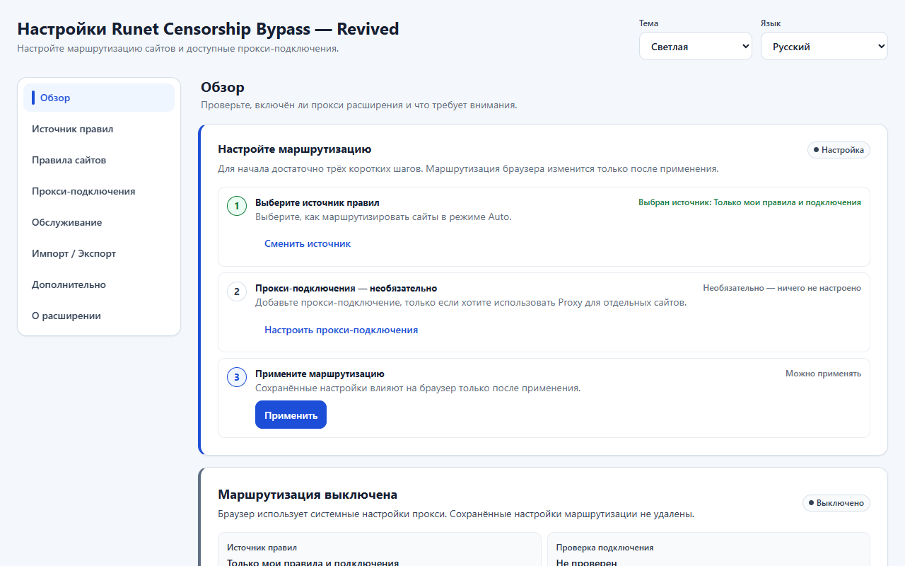
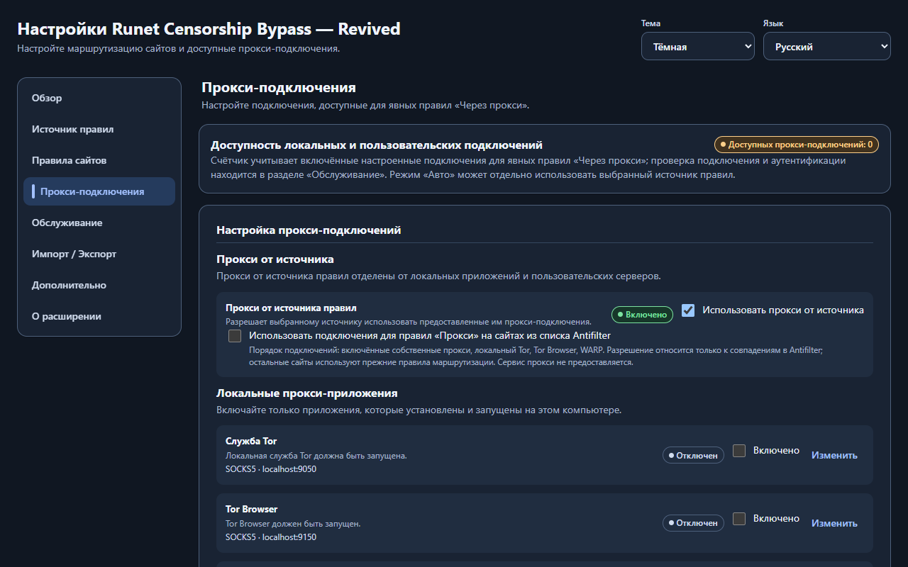
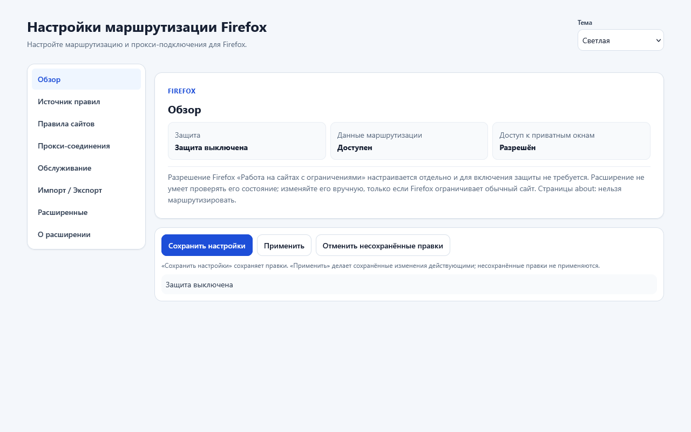
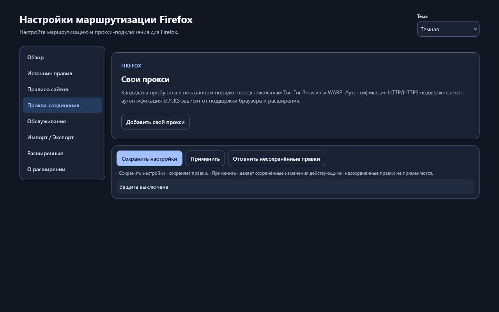

  

# Runet Censorship Bypass — Revived

Независимый форк [Anticensority](https://github.com/anticensority/runet-censorship-bypass).
**Версия 1.0.2 доступна в Chrome Web Store и Firefox Add-ons.**
Для ручной установки также доступны Chromium ZIP и подписанный Firefox XPI.

Выбирайте, как браузер открывает сайты: по автоматическим правилам, через
настроенный прокси или напрямую. Расширение для Chromium и Firefox с интерфейсом
на русском и английском языках.

Расширение не предоставляет VPN или прокси-сервер. Оно использует выбранный
источник маршрутов, ваши прокси и отдельно запущенные Tor, Tor Browser или WARP.

[Установка](docs/user/INSTALLATION.md) ·
[Руководство 1.0.2](docs/user/USER_GUIDE_1_0_2.md) ·
[Помощь и сообщения об ошибках](SUPPORT.md) ·
[Новости](https://github.com/aVitomin/runet-censorship-bypass-revived/issues/105) ·
[Поддержать проект](DONATE.md) ·
[English](#english)

## Скачать

| Браузер | Версия | Установка из магазина |
| --- | --- | --- |
| **Chrome, Brave и совместимые Chromium-браузеры** | **1.0.2** | [Chrome Web Store](https://chromewebstore.google.com/detail/poohkdbmgajmcifcaijdjgiihghlgbph) |
| **Firefox 140+** | **1.0.2** | [Firefox Add-ons](https://addons.mozilla.org/ru/firefox/addon/runet-censorship-bypass-mv3/) |

Магазинные установки получают одобренные обновления через браузер.
Для ручной установки доступны **Chromium ZIP 1.0.2** и
**подписанный Mozilla Firefox XPI 1.0.2**.

Расчётная совместимость **1.0.1–1.0.2** — настольные **Chromium 108+** и
**Firefox 140+**, включая ESR, с необходимыми API.
Это оценка по используемым технологиям, а не проверка каждой версии и каждого
форка. [Требования и проверенные версии](docs/development/BROWSER_COMPATIBILITY.md).

**Ручная установка:** [Chromium ZIP 1.0.2](https://github.com/aVitomin/runet-censorship-bypass-revived/releases/download/v1.0.2/runet-censorship-bypass-mv3-1.0.2-f7ae775.zip) ·
[подписанный Firefox XPI 1.0.2](https://github.com/aVitomin/runet-censorship-bypass-revived/releases/download/v1.0.2/runet-censorship-bypass-firefox-1.0.2-signed.xpi) ·
[изменения и файлы v1.0.2](https://github.com/aVitomin/runet-censorship-bypass-revived/releases/tag/v1.0.2).

В **1.0.2** добавлены список Antifilter, обновление базы из панели и ручной
просмотр ресурсов сайта. [Как пользоваться 1.0.2](docs/user/USER_GUIDE_1_0_2.md).

### Быстрый старт

1. Установите расширение из магазина своего браузера и закрепите его значок.
2. В Firefox разрешите работу в приватных окнах: это нужно для общей настройки прокси.
3. Откройте настройки, выберите источник и нужные подключения.
4. Нажмите **Сохранить настройки**, затем **Применить**.

[Подробная установка, обновление и проверка файлов](docs/user/INSTALLATION.md).
Архивы **Source code** предназначены для разработки.

## Как пользоваться версией 1.0

Откройте сайт и нажмите значок расширения:

| Режим | Что делает |
| --- | --- |
| **Авто** | Следует выбранному источнику и общим правилам |
| **Прокси** | Использует подходящее настроенное подключение |
| **Напрямую** | Обходит прокси расширения для этого сайта |

Правило можно задать для одного хоста или домена с поддоменами. **Напрямую**
имеет приоритет над **Прокси**. В режиме **Только мои правила и подключения**
автоматическая база не нужна.

**Сохранить** записывает настройки, **Применить** включает сохранённые изменения.
До применения продолжают действовать прежние настройки. Обновление базы
не включает выключенную маршрутизацию и не применяет отложенные правки.

[Подключения, источники, перенос настроек и обновления](docs/user/USER_GUIDE_1_0_2.md)

## Интерфейс

В обоих браузерах доступны светлая, тёмная и системная темы, русский и английский.
Ниже показан интерфейс Chromium и Firefox 1.0.2.

Подключения Chromium 1.0.2, тёмная тема

Firefox 1.0.2: светлая и тёмная темы

## Помощь и приватность

Начните с [проверок и формы сообщения об ошибке](SUPPORT.md).
Состояние **Защита включена** означает управление маршрутизацией; оно не
гарантирует доступность сайтов, анонимность или шифрование. Используйте
доверенные источники и прокси.

[Приватность 1.0](docs/release/PRIVACY_1_0.md) ·
[Сообщить об уязвимости приватно](SECURITY.md) ·
[Вся документация](docs/README.md)

Проверить скачанные файлы

**Chromium 1.0.2** — `runet-censorship-bypass-mv3-1.0.2-f7ae775.zip`

SHA-256: `9c04b868cb1d739b38af0f595bc0c487f2183cd63b4ab6256d682279129e257c`

[Контрольная сумма ZIP](https://github.com/aVitomin/runet-censorship-bypass-revived/releases/download/v1.0.2/runet-censorship-bypass-mv3-1.0.2-f7ae775.zip.sha256.txt)

**Firefox 1.0.2** — `runet-censorship-bypass-firefox-1.0.2-signed.xpi`

SHA-256: `35aec76967e2b26198139766c507d828cd95572b86679d5b0e14ff4cdc0ee203`

[Контрольная сумма XPI](https://github.com/aVitomin/runet-censorship-bypass-revived/releases/download/v1.0.2/runet-censorship-bypass-firefox-1.0.2-signed.sha256.txt) ·
[Выпуск 1.0.2](https://github.com/aVitomin/runet-censorship-bypass-revived/releases/tag/v1.0.2)

## English

**Runet Censorship Bypass — Revived** is an independent Anticensority fork.
**Version 1.0.2 is available in Chrome Web Store and Firefox Add-ons.**
Chromium ZIP and Mozilla-signed Firefox XPI 1.0.2 are also available for manual installation.

Choose **Auto**, **Proxy**, or **Direct** for websites in Chromium and Firefox.
The extension controls browser routing and provides no VPN or proxy service.
Save records settings; Apply activates them.

Install from [Chrome Web Store](https://chromewebstore.google.com/detail/poohkdbmgajmcifcaijdjgiihghlgbph) or
[Firefox Add-ons](https://addons.mozilla.org/ru/firefox/addon/runet-censorship-bypass-mv3/).
Expected 1.0.1–1.0.2 minimums are desktop **Chromium 108+** and **Firefox 140+**, including
ESR on a compatible base. See [installation](docs/user/INSTALLATION.md#english-summary),
[the 1.0.2 guide](docs/user/USER_GUIDE_1_0_2.md#english-summary), and [help](SUPPORT.md#english).

Support this independent fork: [donations](DONATE.md#english).

Разработчикам и пользователям старых версий

[Разработка](docs/development/DEVELOPMENT.md) ·
[Архитектура](docs/development/ARCHITECTURE.md) ·
[Тестирование](docs/development/TESTING.md) ·
[Процесс выпуска](docs/development/RELEASE_PROCESS.md) ·
[Участие в проекте](CONTRIBUTING.md)

Firefox 0.0.4.0: [руководство](docs/user/USER_GUIDE.md),
[решение проблем](docs/user/TROUBLESHOOTING.md),
[приватность](docs/user/PRIVACY_AND_SECURITY.md).
[Исторический README](docs/legacy/UPSTREAM_README.md).

Проект основан на [Anticensority](https://github.com/anticensority/runet-censorship-bypass)
с сохранением авторства и истории. Лицензия: [GNU GPL v3](LICENSE).
