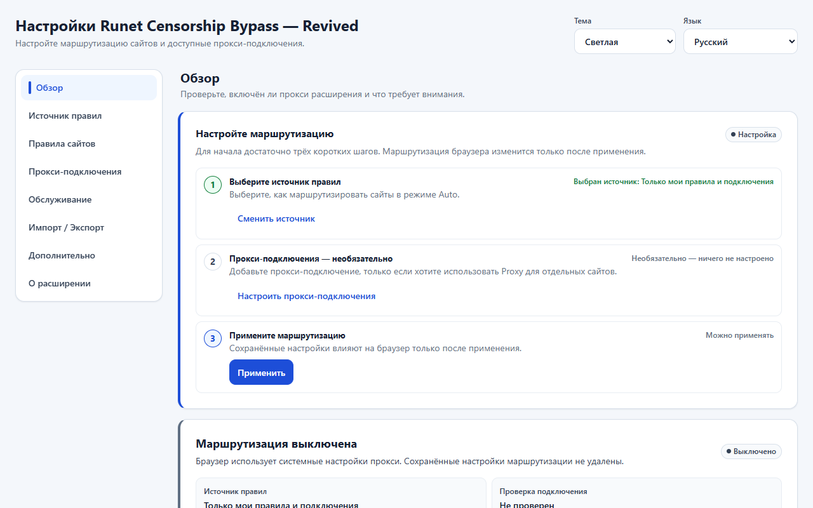
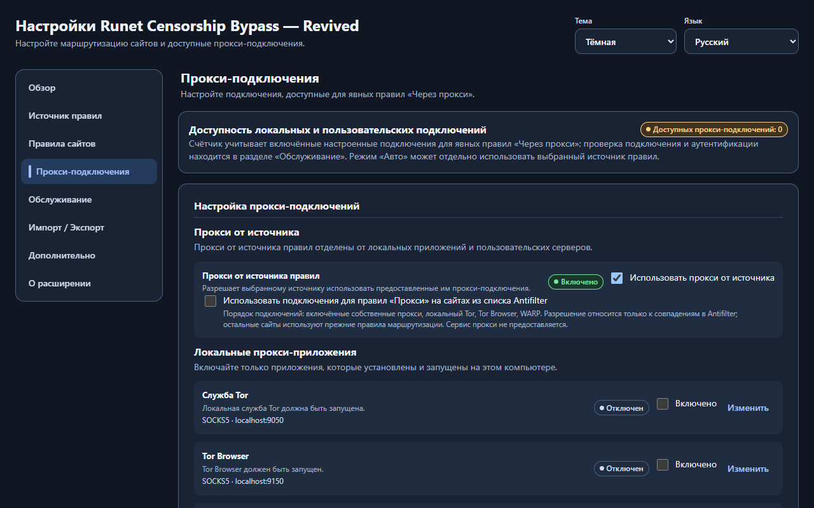
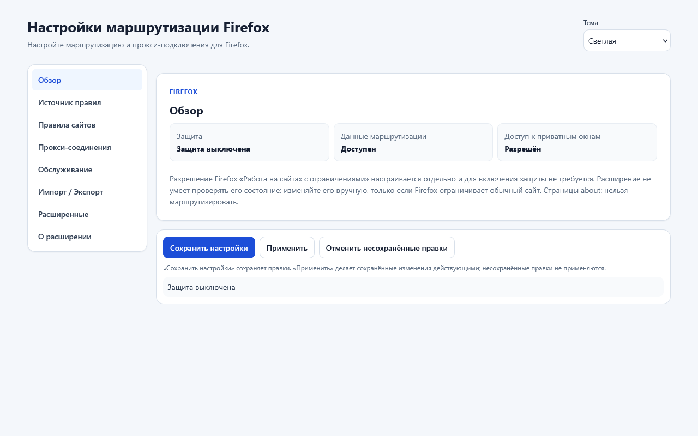
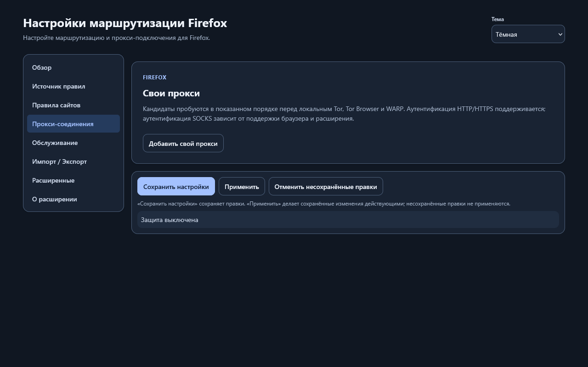

  

# Runet Censorship Bypass — Revived

Независимый форк [Anticensority](https://github.com/anticensority/runet-censorship-bypass).
**Версия 1.1.0 доступна в Chrome Web Store и Firefox Add-ons.**
На GitHub доступны **Chromium ZIP 1.1.0** и подписанный Firefox XPI **1.1.0**.

Выбирайте, как браузер открывает сайты: по автоматическим правилам, через
настроенный прокси или напрямую. Расширение для Chromium и Firefox с интерфейсом
на русском и английском языках.

Две сборки одного проекта: **Chromium** для Chrome, Brave, Edge и совместимых
браузеров; **Firefox** для браузеров на его основе. Обе используют Manifest V3.
Доступность обновления в магазинах проверяется отдельно для каждой сборки.

Расширение не предоставляет VPN или прокси-сервер. Оно использует выбранный
источник маршрутов, ваши прокси и отдельно запущенные Tor, Tor Browser или WARP.

[Установка](docs/user/INSTALLATION.md) ·
[Руководство пользователя](docs/user/GUIDE.md) ·
[Помощь и сообщения об ошибках](SUPPORT.md) ·
[Новости](https://github.com/aVitomin/runet-censorship-bypass-revived/issues/105) ·
[Поддержать проект](DONATE.md) ·
[English](#english)

## Скачать

| Браузер | Версия | Установка из магазина |
| --- | --- | --- |
| **Chrome, Brave и совместимые Chromium-браузеры** | **1.1.0** | [Chrome Web Store](https://chromewebstore.google.com/detail/poohkdbmgajmcifcaijdjgiihghlgbph) |
| **Firefox 140+** | **1.1.0** | [Firefox Add-ons](https://addons.mozilla.org/ru/firefox/addon/runet-censorship-bypass-mv3/) |

Магазинные установки получают одобренные обновления через браузер.
Для ручной установки доступны **Chromium ZIP 1.1.0** и
**подписанный Mozilla Firefox XPI 1.1.0**.

Расчётная совместимость **1.0.1–1.0.3** — настольные **Chromium 108+** и
**Firefox 140+**, включая ESR, с необходимыми API.
Это оценка по используемым технологиям, а не проверка каждой версии и каждого
форка. [Требования и проверенные версии](docs/development/BROWSER_COMPATIBILITY.md).

**Ручная установка:** [Chromium ZIP 1.1.0](https://github.com/aVitomin/runet-censorship-bypass-revived/releases/download/v1.1.0/runet-censorship-bypass-chromium-1.1.0-f8aa606.zip) ·
[подписанный Firefox XPI 1.1.0](https://github.com/aVitomin/runet-censorship-bypass-revived/releases/download/v1.1.0/runet-censorship-bypass-firefox-1.1.0-signed.xpi) ·
[что нового в 1.1.0](https://github.com/aVitomin/runet-censorship-bypass-revived/releases/tag/v1.1.0).

В 1.1.0 появился мастер первого запуска и поддержка Antizapret в Firefox. Панель показывает текущий сайт и его режим маршрутизации.

### Быстрый старт

1. Установите расширение из магазина своего браузера и закрепите его значок.
2. В Firefox разрешите работу в приватных окнах: это нужно для общей настройки прокси.
3. Выберите источник в настройках. В Chromium **Antizapret** может использовать
   прокси своего провайдера. В Firefox прокси-маршрутам **Anticensority** нужна
   совместимая локальная служба, например запущенный Tor. Для **Antifilter**
   в обоих браузерах подключите свой прокси или локальную службу и разрешите
   использовать это подключение для сайтов из списка.
4. Сохраните изменения и нажмите **Применить**. После включения маршрутизации
   откройте или перезагрузите сайт, который входит в список источника или
   совпадает с вашим правилом. Проверьте режим сайта в панели расширения и
   убедитесь, что страница загружается.

[Подробная установка, обновление и проверка файлов](docs/user/INSTALLATION.md).
Архивы **Source code** предназначены для разработки.

## Как пользоваться

Откройте сайт и нажмите значок расширения:

| Режим | Что делает |
| --- | --- |
| **Авто** | Следует выбранному источнику и общим правилам |
| **Прокси** | Использует подходящее настроенное подключение |
| **Напрямую** | Обходит прокси расширения для этого сайта |

Правило можно задать для одного хоста или домена с поддоменами. **Напрямую**
имеет приоритет над **Прокси**. В режиме **Только мои правила и подключения**
автоматическая база не нужна.

**Сохранить** записывает настройки, **Применить** включает сохранённые изменения.
До применения продолжают действовать прежние настройки. Обновление базы
не включает выключенную маршрутизацию и не применяет отложенные правки.

[Подключения, источники, перенос настроек и обновления](docs/user/GUIDE.md)

## Интерфейс

В обоих браузерах доступны светлая, тёмная и системная темы, русский и английский.
Ниже показан интерфейс Chromium и Firefox 1.0.2.

Подключения Chromium 1.0.2, тёмная тема

Firefox 1.0.2: светлая и тёмная темы

## Помощь и приватность

Начните с [проверок и формы сообщения об ошибке](SUPPORT.md).
Состояние **Защита включена** означает управление маршрутизацией; оно не
гарантирует доступность сайтов, анонимность или шифрование. Используйте
доверенные источники и прокси.

[Какие данные получает прокси и источник правил](docs/release/PRIVACY.md) ·
[Сообщить об уязвимости приватно](SECURITY.md) ·
[Вся документация](docs/README.md)

Проверить скачанные файлы

**Chromium 1.1.0** — `runet-censorship-bypass-chromium-1.1.0-f8aa606.zip`

SHA-256: `48168f5ddd5dae48a334917babb73c1ca6947f4e9f68b19dfd8d2d05774fb17d`

**Firefox 1.1.0** — `runet-censorship-bypass-firefox-1.1.0-signed.xpi`

SHA-256: `c784f03867a5106cc2f123894ac2637b3dd50f8adc7b49d12e620703b1c33baf`

[Выпуск 1.1.0](https://github.com/aVitomin/runet-censorship-bypass-revived/releases/tag/v1.1.0)

## English

**Runet Censorship Bypass — Revived** is an independent Anticensority fork.
**Version 1.1.0 is available in Chrome Web Store and Firefox Add-ons.**
Chromium ZIP **1.1.0** and Mozilla-signed Firefox XPI **1.1.0**
are available for manual installation.
[Changes in 1.1.0](https://github.com/aVitomin/runet-censorship-bypass-revived/releases/tag/v1.1.0).

Choose **Auto**, **Proxy**, or **Direct** for websites in Chromium and Firefox.
The extension controls browser routing and provides no VPN or proxy service.
Save records settings; Apply activates them.

Install from [Chrome Web Store](https://chromewebstore.google.com/detail/poohkdbmgajmcifcaijdjgiihghlgbph) or
[Firefox Add-ons](https://addons.mozilla.org/ru/firefox/addon/runet-censorship-bypass-mv3/).
Expected 1.0.1–1.0.3 minimums are desktop **Chromium 108+** and **Firefox 140+**, including
ESR on a compatible base. See [installation](docs/user/INSTALLATION.md#english-summary),
[the user guide](docs/user/GUIDE.md#english-summary), and [help](SUPPORT.md#english).

In Chromium, **Antizapret** can use its provider's proxies. In Firefox,
**Anticensority** proxy routes require a compatible local service such as Tor.
For **Antifilter** in either browser, set up a proxy or local service and allow
the extension to use it for listed sites. Allow private-window access in
Firefox, save changes and select **Apply**. Once routing is active, open or
reload a site covered by the source or a site rule, check its mode in the popup
and confirm that it loads.

Support this independent fork: [donations](DONATE.md#english).

Разработчикам и пользователям старых версий

[Разработка](docs/development/DEVELOPMENT.md) ·
[Архитектура](docs/development/ARCHITECTURE.md) ·
[Тестирование](docs/development/TESTING.md) ·
[Процесс выпуска](docs/development/RELEASE_PROCESS.md) ·
[Участие в проекте](CONTRIBUTING.md)

Firefox 0.0.4.0: [руководство](docs/user/USER_GUIDE.md),
[решение проблем](docs/user/TROUBLESHOOTING.md),
[приватность](docs/user/PRIVACY_AND_SECURITY.md).
[Исторический README](docs/legacy/UPSTREAM_README.md).

Проект основан на [Anticensority](https://github.com/anticensority/runet-censorship-bypass)
с сохранением авторства и истории. Лицензия: [GNU GPL v3](LICENSE).
