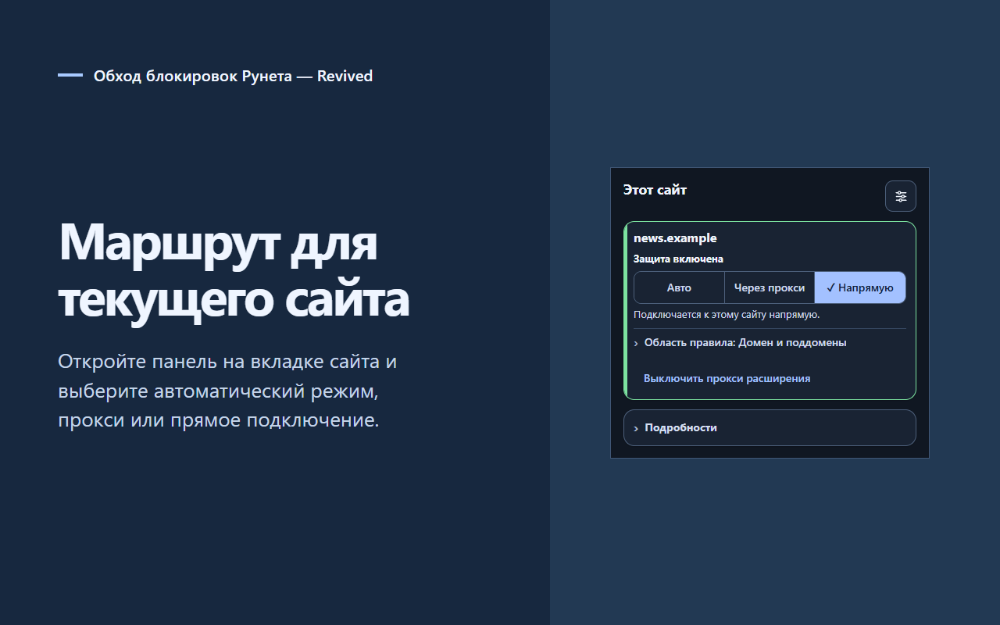

  

# Runet Censorship Bypass — Revived

Выбирайте, как Chromium и Firefox подключаются к сайтам. Для каждого сайта можно выбрать **Авто**, **Через прокси** или **Напрямую**. Расширение управляет настройками браузера и использует прокси выбранного источника или ваше подключение.

[Руководство](docs/user/GUIDE.md) · [Помощь](SUPPORT.md) · [Новости](https://github.com/aVitomin/runet-censorship-bypass-revived/issues/105) · [English](#english)

## Скачать

| Браузер | Из магазина | Вручную с GitHub |
| --- | --- | --- |
| Chrome, Brave, Edge и другие настольные браузеры на Chromium | [Chrome Web Store · 1.1.0](https://chromewebstore.google.com/detail/poohkdbmgajmcifcaijdjgiihghlgbph) | [Chromium ZIP · 1.1.1](https://github.com/aVitomin/runet-censorship-bypass-revived/releases/download/v1.1.1/runet-censorship-bypass-chromium-1.1.1-34f3f65.zip) |
| Firefox для компьютера | [Firefox Add-ons · 1.1.0](https://addons.mozilla.org/ru/firefox/addon/runet-censorship-bypass-mv3/) | [Подписанный Firefox XPI · 1.1.0](https://github.com/aVitomin/runet-censorship-bypass-revived/releases/download/v1.1.0/runet-censorship-bypass-firefox-1.1.0-signed.xpi) |

Магазинная версия обновляется через браузер. Распакованная сборка Chromium обновляется вручную. Смотрите [инструкцию по установке](docs/user/INSTALLATION.md) и [изменения в 1.1.1](https://github.com/aVitomin/runet-censorship-bypass-revived/releases/tag/v1.1.1).

Расчётные минимумы — Chromium 108 и Firefox 140. [Требования и проверенные версии](docs/development/BROWSER_COMPATIBILITY.md).

## Быстрый старт

1. Установите расширение и закрепите его значок. В Firefox разрешите работу в приватных окнах, чтобы расширение могло управлять прокси в браузере.
2. В **Обзоре** выберите источник правил. В Chromium онлайн-источник Antizapret может использовать свои прокси. В Firefox для Antizapret понадобится своё подключение. Для Antifilter нужен свой прокси в обоих браузерах. [Как выбрать источник и прокси](docs/user/GUIDE.md#первый-запуск).
3. Сохраните настройки и нажмите **Применить**. Откройте сайт, который подходит под правило, и проверьте его режим в панели расширения.

## Как пользоваться

- **Авто** следует выбранному источнику и вашим правилам.
- **Через прокси** использует подходящее настроенное подключение.
- **Напрямую** обходит прокси расширения для выбранного сайта.

Задайте правило для одного хоста или домена с поддоменами. Пока сохранённые изменения ждут применения, браузер продолжает пользоваться действующими правилами.

## Интерфейс

В обоих браузерах доступны светлая, тёмная и системная темы. Ниже показана панель сайта в Chromium 1.1.1.

[Снимки Chromium и Firefox на русском и английском](docs/assets/releases/1.1.1/README.md)

## Помощь и приватность

Состояние **Защита включена** означает, что расширение управляет маршрутизацией. Доступность сайта зависит от выбранных правил, источника и подключения.

[Сообщить о проблеме](SUPPORT.md) · [Какие данные получает прокси](docs/release/PRIVACY.md) · [Сообщить об уязвимости приватно](SECURITY.md) · [Поддержать проект](DONATE.md)

Контрольные суммы скачиваемых файлов

- [Chromium 1.1.1](https://github.com/aVitomin/runet-censorship-bypass-revived/releases/tag/v1.1.1) — `runet-censorship-bypass-chromium-1.1.1-34f3f65.zip`. SHA-256 `9fa70108c0764452e74a81f442bda85ef1ce488ffa169a10a67ad2d778726317`.
- [Firefox 1.1.0](https://github.com/aVitomin/runet-censorship-bypass-revived/releases/tag/v1.1.0) — `runet-censorship-bypass-firefox-1.1.0-signed.xpi`. SHA-256 `c784f03867a5106cc2f123894ac2637b3dd50f8adc7b49d12e620703b1c33baf`.

Документация для разработки и старых версий

[Документация](docs/README.md) · [Разработка](docs/development/DEVELOPMENT.md) · [Архитектура](docs/development/ARCHITECTURE.md) · [Тестирование](docs/development/TESTING.md) · [Выпуск](docs/development/RELEASE_PROCESS.md) · [Участие в проекте](CONTRIBUTING.md)

Firefox 0.0.4.0 — [руководство](docs/user/USER_GUIDE.md), [решение проблем](docs/user/TROUBLESHOOTING.md), [приватность](docs/user/PRIVACY_AND_SECURITY.md). [Архив исходного проекта](docs/legacy/UPSTREAM_README.md).

Revived — независимый форк [Anticensority](https://github.com/anticensority/runet-censorship-bypass). [Лицензия GNU GPL v3](LICENSE).

## English

Choose how Chromium and Firefox connect to websites. **Auto** follows the selected source and your rules, **Proxy** uses a configured connection, and **Direct** bypasses the extension proxy for that site. Save records your changes. Apply activates them.

| Browser | Store | Manual download |
| --- | --- | --- |
| Chrome, Brave, Edge and other desktop Chromium browsers | [Chrome Web Store · 1.1.0](https://chromewebstore.google.com/detail/poohkdbmgajmcifcaijdjgiihghlgbph) | [Chromium ZIP · 1.1.1](https://github.com/aVitomin/runet-censorship-bypass-revived/releases/download/v1.1.1/runet-censorship-bypass-chromium-1.1.1-34f3f65.zip) |
| Desktop Firefox | [Firefox Add-ons · 1.1.0](https://addons.mozilla.org/en-US/firefox/addon/runet-censorship-bypass-mv3/) | [Mozilla-signed Firefox XPI · 1.1.0](https://github.com/aVitomin/runet-censorship-bypass-revived/releases/download/v1.1.0/runet-censorship-bypass-firefox-1.1.0-signed.xpi) |

Store installations update through the browser. Update an unpacked Chromium installation manually. The expected minimums are Chromium 108 and Firefox 140. Firefox needs private-window permission for browser-wide proxy control. Antizapret in Firefox and Antifilter in both browsers need your own proxy connection. Chromium can use the proxies of the online Antizapret source.

[Installation](docs/user/INSTALLATION.md#english-summary) · [User guide](docs/user/GUIDE.md#english-summary) · [Support](SUPPORT.md#english) · [Changes in 1.1.1](https://github.com/aVitomin/runet-censorship-bypass-revived/releases/tag/v1.1.1) · [Screenshots](docs/assets/releases/1.1.1/README.md#english) · [Developer docs](docs/README.md#for-developers)

Revived is an independent [Anticensority](https://github.com/anticensority/runet-censorship-bypass) fork. [GNU GPL v3](LICENSE).
